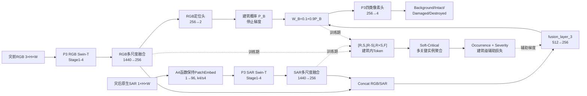
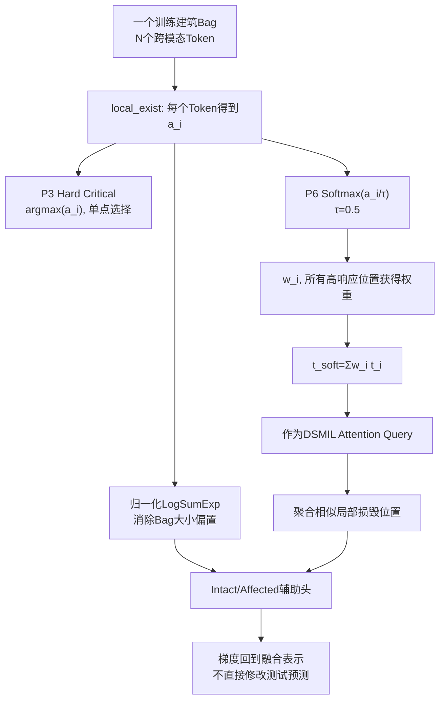
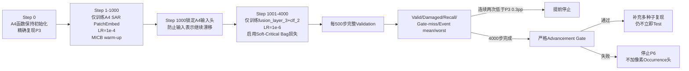

# S8-P6 A4 Soft-Critical MICB阶段汇报

## 1. 研究背景与问题

当前P3在Validation上取得60.5019 Valid mIoU、69.5772 mIoU4和90.57
Localization F1。定位与Intact识别稳定，主要错误是弱Damaged未进入Affected，
Validation Damaged gate-miss约33.09%。

已有受控实验给出两个局部正向信号：A4原生单通道SAR输入适配在Step 1000
达到60.5751 Valid mIoU；关键实例监督是P3相对像素基线的重要训练机制。
N1-shared Cross-Attention虽然相对N0提高Valid和Destroyed，但增加Gate-miss并
降低Event worst，因此不进入本轮组合。

## 2. 模型总览

正式推理保持`mil_residual_scale=0`，Soft-Critical不直接广播到像素logits。

## 3. Soft-Critical底层计算

该修改不增加可训练参数，P3 checkpoint参数命名和严格加载协议保持不变。

## 4. 两阶段4000步训练

## 5. 相对已有模型的受控关系

| 模型 | 本轮采用 | 原因 |
|---|---|---|
| P3 RGB定位/ROI/像素头 | 是 | 已在Validation和Test成立 |
| A4函数保持Native-SAR输入 | 是 | Step 1000有安全微增益，修正伪RGB输入 |
| Soft-Critical MICB | 是，待验证 | 直接针对单点Hard Argmax和弱Damaged梯度 |
| N1-shared Cross-Attention | 否 | Gate-miss +2.80 pp、Event worst -0.29 pp |
| 像素Occurrence新头 | 否 | 只有Soft-Critical通过后才允许增加 |
| MIL像素残差广播 | 否 | 避免建筑级证据直接误伤Intact |

## 6. 准入标准

相对P3必须同时满足：Valid不下降、Damaged IoU至少+0.30 pp、Affected Recall
至少+0.50 pp、Damaged gate-miss至少下降0.50 pp、Event mean/worst不下降，
且至少10/14事件不下降。

## 7. 当前状态与边界

目前完成的是代码实现与本地语法验证，不是已经获得提升。PyTorch单元测试、
Exact Guard、Smoke和4000步Validation需在服务器bright5090环境运行。只有Gate
通过并完成额外种子复现后，才讨论一次固定Test。

