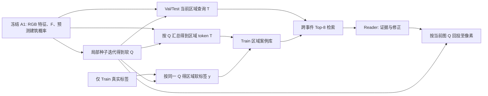

# SRAC 风格超像素与 Memory：本地代码、实验和相关论文核查

日期：2026-10-10。本文回答三个问题：现有软超像素 Q 如何生成；Train 区域 Memory 如何建、如何读取，Q 在其中起什么作用；SRAC 之外有哪些真正把超像素与原型或记忆结合的工作，它们哪些设计可以迁移。核查材料为本地代码、用户给出的五路径与 E0/E1 Val 数据，以及所列论文和作者仓库。文献检索分别追踪“superpixel＋persistent prototype memory”“superpixel＋offline retrieval”“few-shot regional prototypes”及“learnable superpixels”，只把论文原文和作者代码相互印证的机制当作已核实机制；排除仅指 GPU 内存消耗的“memory”和把即时 support 误称长期库的结果。本次没有重新运行训练、450 张 Val 或正式 Test。五路径数值来自用户表格，本地没有核验该表对应的服务器 JSON。

**先区分名称。** [IGARSS 2026 的 SRAC 页面](https://2026.ieeeigarss.org/view_paper.php?PaperNum=2851&SessionID=1356)目前只展示标题和会议信息，未提供足以逐模块核对的论文全文或官方代码。本地 [`model.py`](/D:/software/dowmload/BRIGHT-master/bda_benchmark/experiments/damageformer_srac_transformer_v1/model.py:1)也明确称自身为对公开示意图的 *auditable approximation*。下文“当前 SRAC”指仓库里的 SRAC 风格实现，不声称这是原作者方法的严格复现。

## 一、当前超像素 Q 的生成

前端先冻结原 A1。A1 提供四级**灾前 RGB** Swin 特征、用于损毁分类的 256 维灾前/灾后融合像素特征 F，以及**预测**建筑概率 B。轻量 UNet++ 风格解码器把四级 RGB 特征合成为默认 64 维结构特征。因此 Q 的形状线索主要来自灾前结构，而损毁语义主要还要靠后面的融合特征及分类/Memory；不能把 Q 当成“按损毁类别切开的区域”。B 是模型输出，非真实建筑掩膜，生成 Q 时会被 `detach`；GT 灾损标签不进入 Q。[前端和冻结 A1](/D:/software/dowmload/BRIGHT-master/bda_benchmark/experiments/damageformer_srac_transformer_v1/model.py:343)、[前向连接](/D:/software/dowmload/BRIGHT-master/bda_benchmark/experiments/damageformer_srac_transformer_v1/model.py:401)。

在**特征网格**按默认 stride=8 布置候选种子；每个网格位置只比较所属种子及其周围 8 个种子。如果特征网格为 256×256，初始种子网格就是约 32×32。它们是候选区域中心，不是 1024 栋建筑，也不是原图每 8 像素一个方块。[候选 ID 生成](/D:/software/dowmload/BRIGHT-master/bda_benchmark/experiments/damageformer_a1_cross_modal_superpixel_v1/association.py:12)。

每轮用当前归属权重更新种子的特征、位置、建筑概率；对位置 i 和局部候选 r 打分，可概括为

\[
a_{ir}=\frac{\gamma\,\operatorname{sim}(f_i,c_r)}{\tau}
-\lambda_s\|x_i-\bar x_r\|^2
+\lambda_b\log\{B_i\bar B_r+(1-B_i)(1-\bar B_r)\}.
\]

归一化相似度有可学习投影和缩放；还会屏蔽越界及空中心。默认迭代 3 次、温度 0.2、空间权重 0.1、建筑相容权重 0.5，再在 9 个候选上做 softmax 得到稀疏软归属 `Q[B,9,H_f W_f]`。**具体运行值须以 checkpoint 配置为准。** Q 是特征、空间和建筑先验共同形成的软分区，不是 SLIC，不保证连通，也不保证“一个区域=一栋建筑=一种损毁类别”。[分区打分和归属](/D:/software/dowmload/BRIGHT-master/bda_benchmark/experiments/damageformer_srac_transformer_v1/model.py:79)。

分区器、解码器、结构适配器、区域表示和新区域头共同训练；冻结 A1，损失来自 Q 回投后的像素 NLL 与 Lovász。当前训练代码里没有独立的区域边界或紧致度损失。因此“建筑概率相容”是软诱导，不是建筑边界保证。[训练损失](/D:/software/dowmload/BRIGHT-master/bda_benchmark/experiments/damageformer_srac_transformer_v1/train_front.py:185)。

## 二、Q 如何变成区域表示、标签和 Memory

把 Q 看作每个网格像素对邻近区域的分配表，定义区域均值运算 `P_Q` 和回投 `U_Q`：

\[
(P_Q X)_r=\frac{\sum_i Q_{ir}X_i}{\sum_i Q_{ir}},\qquad
(U_Q Z)_i=\sum_r Q_{ir} Z_r.
\]

实际存入 bank 的 key 并非简单 `P_Q F`。模型先把 F 与 B、Q 的软边界及熵结合，再用 Q 与学习到的空间权重汇总；另加原 F 在 Q 内的均值/标准差旁路和区域质量、中心、跨度等几何编码，产生 128 维 token `T_r`。默认实验未开启额外区域自注意力。直接 `region` 分支把 T 送入新区域分类头，再以**同一 Q**回投区域概率。[区域 token](/D:/software/dowmload/BRIGHT-master/bda_benchmark/experiments/damageformer_srac_transformer_v1/model.py:271)、[区域概率回投](/D:/software/dowmload/BRIGHT-master/bda_benchmark/experiments/damageformer_srac_transformer_v1/model.py:303)。

建库时逐一处理完整 Train 图像，当前清单计 2918 张；先把 Train GT 四类 one-hot 及有效掩膜面积下采样到 Q 网格，再用**相同 Q**汇总为区域真实软标签：

\[
y_r(c)=\frac{\sum_i Q_{ir}\,\mathrm{GT}_{i,c}}{\sum_i Q_{ir}\,\mathrm{valid}_i}.
\]

例如 0.7 Intact、0.3 Damaged 只表示**这个软区域覆盖的标注像素组成**，不能读成某栋楼的损毁程度为 30%。GT 只生成 Train 条目的软标签，不参与 Q 计算或查询键。[区域软标签](/D:/software/dowmload/BRIGHT-master/bda_benchmark/experiments/damageformer_srac_transformer_v1/common.py:160)。

每张 Train 图先保存候选缓存：128 维 token（FP16）、四类软标签（FP32）、有效标注质量、几何、区域质量、事件/图像/区域编号及灾种。只有有效标注质量正、区域质量大于 `1e-6`、主类纯度达到设定值的条目有资格入 bank。默认 `min_purity=0`，**混合区可进入 bank**。接着按“事件 × 软标签最大项类别”分桶，以随机优先级保留每桶最多 64 条；这是有配额的随机选样，不是 K-means、多样性优化或难例专选，实际参数以 manifest 为准。[缓存字段与入库](/D:/software/dowmload/BRIGHT-master/bda_benchmark/experiments/damageformer_srac_transformer_v1/build_memory.py:90)、[默认参数](/D:/software/dowmload/BRIGHT-master/bda_benchmark/experiments/damageformer_srac_transformer_v1/build_memory.py:28)。

因此 Q 在当前系统中同时规定：**查询单位、历史案例单位、历史标签的汇总范围、Reader 证据的空间回投范围**。它的错误也会同时进入这些环节：跨类混合会降低标签纯度；token 与标签若强调同一区域的不同像素，检索 key 与 value 可能不匹配；错误修正按 Q 回投时会波及它覆盖的像素。不过这些是可能机制，不能仅由最终 mIoU 下降推断已发生。[Q 与标签的不同汇总路径](/D:/software/dowmload/BRIGHT-master/bda_benchmark/experiments/damageformer_srac_transformer_v1/model.py:285)、[软标签路径](/D:/software/dowmload/BRIGHT-master/bda_benchmark/experiments/damageformer_srac_transformer_v1/common.py:160)。

## 三、Memory 目前怎样检索和影响输出

J2 在 T128 上以余弦相似度全局取 Top-8；J3 把当前与 bank 的 T128 一起经过已训练投影后再取余弦 Top-8。两者都严格排除与查询相同事件和相同图像，取到的是 bank 行号；J3 Reader 读取的还是**原始条目载荷**，不是把投影特征替换到所有位置。Top-8 只代表排名前八，不能保证绝对相似度足够高，也没有强制八条来自不同事件。[投影与选择](/D:/software/dowmload/BRIGHT-master/bda_benchmark/experiments/damageformer_srac_qmetric_v1/metric.py:535)、[取回支持](/D:/software/dowmload/BRIGHT-master/bda_benchmark/experiments/damageformer_srac_qmetric_v1/metric.py:589)。

旧 J1/J2/J3 的 Reader 以当前 token 为 query、历史支持 token 为 key；value 将支持 token、软标签、事件/灾种/几何嵌入结合，经交叉注意力输出增强 token。J1 使用学习到的无历史槽位；J2/J3 使用检索支持，缺失位也以学习槽补齐。Reader 输出再按**当前 Q**回投为像素上下文，与 A1 的像素特征通过可训练的联合头分类。[Reader](/D:/software/dowmload/BRIGHT-master/bda_benchmark/experiments/damageformer_srac_joint_context_v1/model.py:61)、[联合分类](/D:/software/dowmload/BRIGHT-master/bda_benchmark/experiments/damageformer_srac_joint_context_v1/model.py:215)。旧头虽从 A1 像素权重初始化，训练时像素头会变化；J1/J2/J3 也是各自训练，所以旧分数之间不是严格同一权重只开关检索的因果差。旧 J3 投影只用 bank 中高纯度区域训练，实际查询却有混合与困难区域；这种分布差距值得验证，不能当作已证实根因。[旧投影训练](/D:/software/dowmload/BRIGHT-master/bda_benchmark/experiments/damageformer_srac_qmetric_v1/train_metric.py:54)。

较新的 hardquery 分支已写出全 Train 困难查询采样、软标签相容的检索训练，以及“固定 J1 + 有界修正 + 门控/空支持拒绝”；门控输入包含绝对相似度、间隔、标签熵、支持纯度和事件多样性。但从对话中已完成的正式记录，只能确认 E0/E1，不应把 E2/E3 描述成已验证的收益。这条新分支的固定基线仍是 J1，不是下面五路径中的 `grid_probq`。[查询准备](/D:/software/dowmload/BRIGHT-master/bda_benchmark/experiments/damageformer_srac_hardquery_memory_v1/prepare_queries.py:67)、[可拒绝修正头](/D:/software/dowmload/BRIGHT-master/bda_benchmark/experiments/damageformer_srac_hardquery_memory_v1/reader.py:165)。

## 四、已有实验到底说明 Q 有没有收益

在用户给出的同轮五路径表中，F 为 A1 的原 256 维像素特征，H 为其原分类头，S 为 softmax，P/U 由同一 Q 计算：[四个诊断分支代码](/D:/software/dowmload/BRIGHT-master/bda_benchmark/experiments/damageformer_srac_stage_diagnostics_v1/feature_core.py:65)。

| 路径 | 实质 | 前景 mIoU | 与 pixel_grid 差值 |
|---|---|---:|---:|
| `pixel_grid` | 像素先经原 H 分类 | 61.4194% | 0 |
| `feature_mean` | F 先按 Q 汇总/回投，再用原 H | 61.5373% | +0.1179 百分点 |
| `region_mean` | F 按 Q 汇总，用原 H 分类，再 Q 回投 | 61.7127% | +0.2933 百分点 |
| `grid_probq` | 像素先经原 H 得概率，再 Q 汇总/回投 | **61.8381%** | **+0.4187 百分点** |
| 原生 `region` | Q + 新 T128 + 新区域头 + Q 回投 | 61.4220% | +0.0026 百分点 |

这提供了清楚的**正向证据**：固定 F 和 H 时，当前 Q 所做的区域信息共享在该次实验有用。`region` 另换了表示 T 与分类头，其低于 `grid_probq` 的 0.4161 个百分点不能单独归因于“Q 切得不好”。同样，这张表没有比较同预算 SLIC、规则网格或其他 Q，也没报告四类和逐事件，因此还不能断言当前 Q 已最佳，或 Damaged 一定改善。原生 A1 与 `pixel_grid` 的 softmax/插值顺序不同；五路径旧诊断与后来 legacy E0/E1 的数值配置也未对齐，不直接跨轮减分。[结果来源和可比性说明](/D:/software/dowmload/BRIGHT-master/notes/insights/20261010-region-constraint-evidence-and-memory-wiring.md:3)。

另一次正式 E0/E1 对话记录中，450 张 Val 及复现/不可变检查通过；报告的前景 mIoU 为 A1 61.686685%、直接区域 61.422202%、J1 61.637967%、J2 61.649894%、J3 61.657357%。简单标签读出却只有 58.772754%（原余弦）及 55.859074%（旧投影）；相对 J1，J3 净增加 9499 个 Damaged 假阳性像素，其中真实 Intact 净增加 11172 个；简单读出的净新增 Damaged 假阳性主要来自真实 Intact。这些是**像素数，不是建筑数**。它们说明裸标签投票易误导，但不能单独证明根因是 Q、库、检索还是 Reader。[既有实验记录与解释](/D:/software/dowmload/BRIGHT-master/notes/insights/20261010-srac-memory-rebuild-after-intact-false-positives.md:1)。

## 五、SRAC 之外，文献实际怎样结合超像素与 Memory

下面按“Memory 的生命周期及超像素的位置”区分，避免把所有区域原型都误称为跨数据集标注库。

| 工作和代码 | 超像素/区域怎样用 | Memory/支持怎样用 | 能借鉴什么；不能直接照搬什么 |
|---|---|---|---|
| [PMN，WACV 2023 论文](https://openaccess.thecvf.com/content/WACV2023/papers/Lee_Unsupervised_Video_Object_Segmentation_via_Prototype_Memory_Network_WACV_2023_paper.pdf)；[作者代码](https://github.com/Hydragon516/PMN) | RGB 与光流各做 SLIC；在编码特征上按掩膜平均形成部件原型 | 每帧新原型与旧记忆一同评分，选有用的 Top-K，供下一帧做像素相关匹配 | 最贴近“超像素→原型→显式记忆”；可借鉴有限容量下挑有用的支持。它是无监督视频序列内的在线特征记忆，没有跨灾害 Train GT 软标签；作者仓库的训练/评估说明仍为 TBD，不能视作开箱即复现。见[原型池化](https://github.com/Hydragon516/PMN/blob/main/model/model_for_DAVIS.py#L137-L167)、[评分/更新](https://github.com/Hydragon516/PMN/blob/main/model/model_for_DAVIS.py#L415-L459)。 |
| [FreeDA，CVPR 2024 论文](https://openaccess.thecvf.com/content/CVPR2024/papers/Barsellotti_Training-Free_Open-Vocabulary_Segmentation_with_Offline_Diffusion-Augmented_Prototype_Generation_CVPR_2024_paper.pdf)；[作者代码](https://github.com/aimagelab/freeda) | **测试图**用 Felzenszwalb 超像素，汇总 DINOv2 区域特征，与类原型做局部相似性 | 离线由生成图、词位置掩膜得到视觉原型；**类别文本**通过 FAISS 检索文本 key 后取对应视觉 value，再与查询区域比较并融合全局 CLIP | 很好的“离线原型库 + 查询区域 + 局部/全局融合”先例；但库不是把 Train 的每个超像素及 GT 类标存起来，检索入口是类别文本而非图像区域 token。见[超像素代码](https://github.com/aimagelab/freeda/blob/main/src/models/freeda/mask_proposer/superpixel.py#L16-L110)、[文本检索](https://github.com/aimagelab/freeda/blob/main/src/models/freeda/freeda.py#L295-L368)、[区域匹配](https://github.com/aimagelab/freeda/blob/main/src/models/freeda/freeda.py#L463-L533)。作者仓库提供预制索引和评估入口；此次未在公开树中找到完整的离线生成库脚本。 |
| [ASGNet，CVPR 2021 论文](https://openaccess.thecvf.com/content/CVPR2021/papers/Li_Adaptive_Prototype_Learning_and_Allocation_for_Few-Shot_Segmentation_CVPR_2021_paper.pdf)；[作者代码](https://github.com/Reagan1311/ASGNet/blob/main/model/asgnet.py#L198-L250) | 支持图的前景区域通过超像素引导的特征聚合，产生多个代表 | query 匹配并分配这些支持原型，属于每个 few-shot episode 的即时支持集 | 借鉴“一个类别不止一个外观代表”和局部匹配；它没有固定的长期跨事件 bank，不能证明扩大当前库或离线聚类会提高 BRIGHT。 |
| [RPT，MICCAI 2023 论文](https://arxiv.org/pdf/2309.04825)；[作者代码](https://github.com/YazhouZhu19/RPT/blob/main/models/fewshot.py#L270-L359) | 超体素用于自监督训练伪掩码；推理支持前景实际采用 Voronoi 式区域划分，再形成多个原型 | 用查询原型筛掉不相容支持区域，属于即时支持集 | 可借鉴“有支持也要筛选”；不能称其在推理时把超体素存进长期 Memory。 |
| [SEAMAL，TMI 2024 摘要](https://scholars.cityu.edu.hk/en/publications/learning-a-single-network-for-robust-medical-image-segmentation-w/) | 在超像素层面更新被判可靠的标签 | 预测历史 Memory 用于训练时辨别和修正噪声标注 | 说明超像素也可承担标签校正单位；这里 Memory 服务训练监督清洗，不是测试时检索相似历史图。此次未核实作者代码，不给代码迁移结论。 |

生成 Q 的邻近文献是 [SSN，ECCV 2018 论文](https://www.ecva.net/papers/eccv_2018/papers_ECCV/papers/Varun_Jampani_Superpixel_Sampling_Networks_ECCV_2018_paper.pdf)、[作者代码](https://github.com/NVlabs/ssn_superpixels) 和 [SpixelFCN，CVPR 2020 论文](https://openaccess.thecvf.com/content_CVPR_2020/papers/Yang_Superpixel_Segmentation_With_Fully_Convolutional_Networks_CVPR_2020_paper.pdf)、[局部归属代码](https://github.com/fuy34/superpixel_fcn/blob/master/models/Spixel_single_layer.py#L45-L89)：它们研究可微或局部候选区域分配。SSN 特别展示了用区域重建和紧致性损失训练 Q 的另一种办法；这可作为未来 **Q 明确被诊断为瓶颈之后**的消融，而非当前直接添加损失的依据。二者**自身不提供这种跨事件带软标签检索库**。更早的 [Lucks 等人，VISAPP 2019](https://www.scitepress.org/PublishedPapers/2019/72538/) 在航拍屋顶上按超像素提纹理/光谱特征，再用随机森林分损毁与未损毁；它是同应用领域的区域分类先例，但没有本文这种可查询的跨事件 Memory，且本次未核实作者代码。PMN 论文在它自己的视频任务中比较同样数量的随机/网格/超像素原型，FreeDA 论文比较有无超像素区域匹配，均给出正向消融；这些并不能把论文数值或最优区域算法迁移到 BRIGHT。[PMN 论文](https://arxiv.org/pdf/2209.03712)、[FreeDA 论文](https://arxiv.org/pdf/2404.06542)。

## 六、从这些论文和现有实验推导怎样重建 Memory

先明确结论的证据等级。**已观察到**当前 Q 在固定 F/H 的区域概率共享有益，且简单历史标签读出严重误报 Intact；**代码确认**当前 bank 存 T128+Train 软标签，旧 Reader 通过区域上下文影响像素头；**待验证**T 是否与软标签匹配、是否该换均值 key、是否该多样性选样、困难查询训练与拒绝能否提高最终 IoU。不要把可行机制写成已实现的提升。

1. **先保留 Q，诊断三个连接处。** 在统一 legacy/strict 协议下复核五路径四类及逐事件结果；看 Q 对 GT 的区域类别纯度/熵、Damaged↔Intact 边界混合率、区域大小与空区比例，必要时再做等区域数的 SLIC/规则网格对照。GT 只能用于 Train 建库或 Val 只读诊断，不能在 Val/Test 推理时用来调整 Q、筛选查询或检索。固定 F/Q，分别给 `P_Q F` 与 T128 训练匹配的小头，查清直接 `region` 的落差是表示、分类头还是训练造成。若有建筑实例掩膜，再测“一建筑多区域/一区域跨建筑”；没有实例 GT 就不要假定能测建筑数量。
2. **先保留同一 bank 成员，再比较 key。** 每个条目保留 `(event,image,region)`、原 T128、真实软标签、区域质量/纯度/几何；另外从同一冻结前端重提 `P_Q F` 作为候选 key。先固定成员、标签、Reader 载荷和容量，仅换检索 key，检查跨事件 Top-8 的类别相容性、绝对相似度、事件多样性及“真实 Intact/J1 正确却被参考推向 Damaged”的 Train 查询。`P_Q F` 无法从旧 T128 无损反解，不能直接混接旧投影的 128 维接口。[原 bank 字段](/D:/software/dowmload/BRIGHT-master/bda_benchmark/experiments/damageformer_srac_transformer_v1/build_memory.py:100)。
3. **把供推理用的可靠支持与供训练用的困难查询分开。** 库可以试高纯度支持、少量保留的混合软标签区；查询要包含 Train 内 J1 漏判 Damaged、J1 本来判对却被 Memory 误导的 Intact，以及普通区域。跨事件同类/异类与软标签重叠共同训练相似性，优先比较 Damaged↔Intact 混淆负例。当前 hardquery 分支已有一部分这种机制，应先把其 E2/E3 正式做完，再设计新增对照；不能把同一个机制再当成新贡献。[困难查询代码](/D:/software/dowmload/BRIGHT-master/bda_benchmark/experiments/damageformer_srac_hardquery_memory_v1/metric_learning.py:33)。
4. **把历史证据作为可拒绝的修正。** 简单 Top-8 softmax 标签投票即使所有相似度都低也会强制八个邻居共占 100% 投票权。Reader 应同时看绝对相似度、标签冲突、有效支持量、不同事件数和当前基线的类别间隔；训练“有参考但参考是错的”情形，并约束修正幅度。若以固定 `grid_probq` 为新增强基线，定义当前图区域概率 `π=P_Q softmax(HF)`，Reader 给候选概率 `ρ` 和门控 `g`，再用 `π_new=(1-g)π+gρ`、`p_new=U_Q π_new`（随后沿用原概率插值与归一化）。全局 `g=0` 必须数值上精确回到固定基线；由于 Q 的软重叠，某**一个**区域 `g_r=0` 不能保证它覆盖的所有像素完全不变。不能把已回投平滑的 `grid_probq` 再按 Q 汇总一次，也不能直接把旧固定 J1 的修正头权重搬到新概率基线上。[已有接线分析](/D:/software/dowmload/BRIGHT-master/notes/insights/20261010-region-constraint-evidence-and-memory-wiring.md:125)。
5. **最后再检验建库策略。** PMN 的受益是“挑选有用原型”而不是“容量无上限”；ASGNet 的受益是类内多样代表而非单中心。当前 bank 已有事件×类配额，应先看跨事件过滤后是否缺支持、Top-8 是否重复、每事件/类覆盖与纯度。只有诊断显示瓶颈时，才在相同条目数、同一 Q 和 Reader 下比较随机 reservoir 与多样性/混淆型选样；不能一边换 Q、一边扩库、一边换 Reader，再把分数归因于超像素。

实际重建时还要遵守数据依赖：若只换随机/多样性选样，同一前端产生的完整 Train 区域缓存可以复用；若只换检索投影，需要重算或保存 bank 与查询的投影 key，但不应偷偷改支持标签；若换 Q、结构解码器、A1 或区域 token 定义，就要用同一新前端**重新提取整个 Train 缓存和库**，Val/Test 查询也需同版前端。每版记录前端与 bank 的 checkpoint/hash、Q 配置、输入列表、数值协议及行级 `(event,image,region)` 来源，才可审查检索是否真的引用了想要的案例。[现有 manifest 与 bank 保存](/D:/software/dowmload/BRIGHT-master/bda_benchmark/experiments/damageformer_srac_transformer_v1/build_memory.py:70)。

正式决策看固定共同基线上的四类 IoU、前景 mIoU、逐事件、Damaged 救回与正确样本伤害、真实 Intact→Damaged 假阳性、拒绝率/接受率和支持质量。Val 用于选择方案，**正式 Test 只做最终冻结方案的一次独立检验**；此前讨论的五路径/E1 结果不应写成 Test 成绩。

核心判断：现有超像素已经体现了**图内信息共享**的价值。跨事件 Memory 还需要证明更强的命题：由 Q 定义的区域 key 真能找到语义相容的历史标签，并且 Reader 能在证据不可靠时拒绝它。两件事相关，但不能相互代替。
