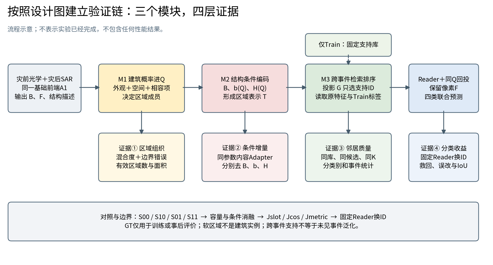

# 建筑损毁论文：方法设计与验证材料

本目录按用户提供初稿的图1—图3重新组织方法和验证实验。所有历史性能分数已移除，成绩保留为待填；本目录不表示任何新实验已经完成。

## 下载

- [完整下载包：Word、PDF、Excel及示意图](../../bright_paper_delivery_20261016.zip)
- [论文正文 Word](paper_draft.docx) · [PDF](paper_draft.pdf) · [在线阅读文本](paper_draft.md)
- [实验与配图规划 Word](experiment_and_figure_plan.docx) · [PDF](experiment_and_figure_plan.pdf) · [在线阅读文本](experiment_and_figure_plan.md)
- [可填写实验表格 Excel](experiment_tables.xlsx)
- [方法与证据链示意图](method_evidence_diagram.png)

Word、PDF和Excel页面如未自动下载，可点击文件页的 **Download raw file**。

## 文件范围

包含三项方法设计、匹配对照、19张实验/配图规划表、文献入口、空表和图注。示意图不属于实验效果图。Train、Val、Test的信息边界、固定Reader对照以及检索相关度与分类收益的区别，详见规划正文。

未包含用户原始上传文档、原始影像、标签数据、模型权重或服务器日志。参考文献的在线核验范围和访问限制在规划第15节说明。

